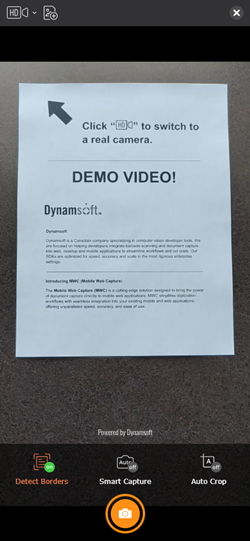

# Introduction

When digitizing physical documents - whether for easier storage, better accessibility, or streamlined processing - a hardware scanner is often the preferred choice. However, when hardware scanners are not feasible or convenient, mobile device cameras can serve as effective alternatives. To address this need, Dynamsoft created the **Mobile Document Scanner JavaScript Edition (MDS) SDK**.

> [!TIP]
> If you are integrating **hardware scanners** into web applications, you may be interested in **Dynamsoft's** [**Dynamic Web TWAIN**](https://www.dynamsoft.com/web-twain/docs/introduction/index.html) solution.

## Common Usage Scenarios

1. **Single Page Capture** – Capture a single, clear image of a physical document, such as an invoice or patient-intake form. This is the core functionality of MDS. You can try this feature in the [**MDS demo**](https://demo.dynamsoft.com/document-scanner/). If it meets your needs, feel free to go directly to the [**MDS user guide**](/guide/index.md).
2. **Multi-Page Capture** – Capture images of multiple document pages (e.g., a contract). You can further leverage our Dynamsoft Document Viewer (DDV) for built-in PDF support, editing, annotations, and more. See our [sample for reference](https://demo.dynamsoft.com/document-scanner/multi-page-scanner/).
3. **Advanced Document Management** – Handle multi-page documents, **multiple documents**, PDF files, annotations, and more with the Mobile Web Capture advanced sample project. Check out the [**online demo**](https://demo.dynamsoft.com/mobile-web-capture/), or read the [**developer guide**](https://www.dynamsoft.com/mobile-document-scanner/docs/web/code-gallery/mobile-web-capture/index.html) to try it for yourself.

## Design Principles

We designed **MDS** with three core principles in mind:

1. **Minimal Code** - High-level APIs provide full functionality with just **a couple of lines of code**, significantly reducing development and maintenance costs.
2. **Ready-to-Use UI** - Pre-integrated components and a pre-designed UI enable a **quick setup** while minimizing design efforts.
3. **Effortless Customization** - Tailored configuration objects allow for **easy workflow customization**, addressing common document scenarios without adding development complexity.

The following example demonstrates how simple it is to power a complete document scanning workflow, including all UI elements:

```javascript
const documentScanner = new Dynamsoft.DocumentScanner({
	license: "YOUR_LICENSE_KEY_HERE",
});
await documentScanner.launch();
```

The UI elements are modularized into distinct Views, each offering developer-friendly configuration options. These options enable flexible business logic through straightforward configuration objects, helping to reduce development costs and streamline maintenance.

The following section provides a high-level overview of the Views.

## Views

MDS workflows are composed of **Views**, each of which comes **ready-to-use** and can be easily customized using configuration objects. These include the following Views for document scanning and correction:

1. **Document Scanner View** – Captures documents using a camera scanner.
2. **Document Correction View** – Applies further perspective cropping and adjustments.
3. **Document Result View** – Provides a preview of the scanned document.

### Highlight: Document Scanner View



The **Document Scanner View** captures scans of documents. It automatically detects document boundaries in the video feed and can optionally select the best frame for scanning, eliminating the need for users to manually snap the image.

## System Requirements

### Secure Context (HTTPS Deployment)

When deploying your web application for production, ensure it is served over a **secure HTTPS connection**. This is required for the following reasons:

1. **Browser Security Restrictions** – Most browsers only allow access to camera video streams in a secure context.

	> [!NOTE]
	> Some browsers like Chrome may grant access to camera video streams for `http://127.0.0.1`, `http://localhost`, or even pages opened directly from the local file system (`file:///...`). This can be helpful during development and testing.

2. **Dynamsoft License Requirements** – A secure context is required for **Dynamsoft licenses** to function properly.

### Supported Browsers

MDS requires the following browser features:

1. [`WebAssembly`](https://caniuse.com/?search=WebAssembly)
2. [`Blob`](https://caniuse.com/?search=Blob)
3. [`URL`](https://caniuse.com/?search=URL)/[`createObjectURL`](https://caniuse.com/?search=createObjectURL)
4. [`Web Workers`](https://caniuse.com/?search=Worker)

The table below lists the **minimum supported versions** of browsers based on these requirements:

| Browser | Version |
| :-----: | :-----: |
| Chrome  |  v78+   |
| Firefox |  v79+   |
| Safari  |  v15+   |
|  Edge   |  v92+   |

## Next Step

Proceed to the [Mobile Document Scanner Developer Guide](/guide/index.md) to build your own document scanning web application.
